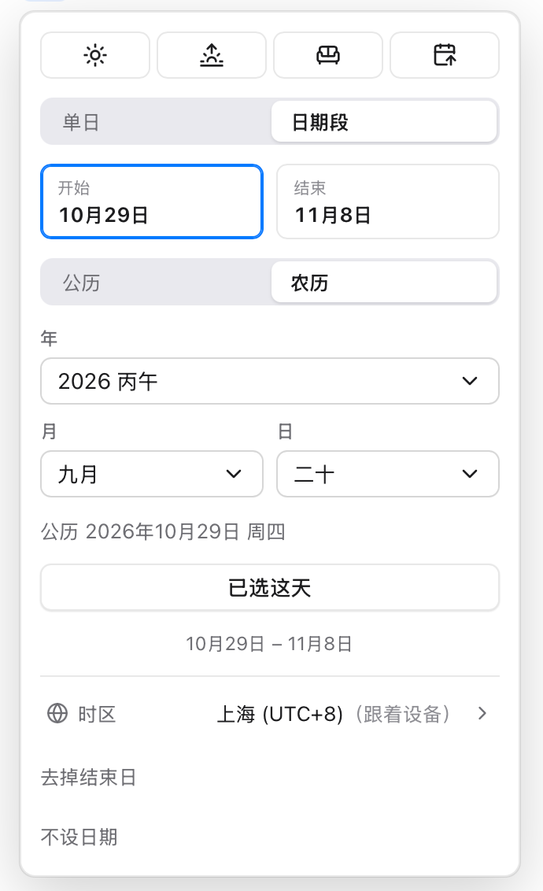
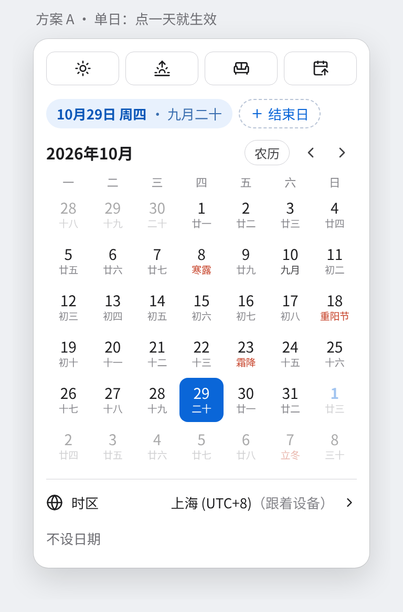
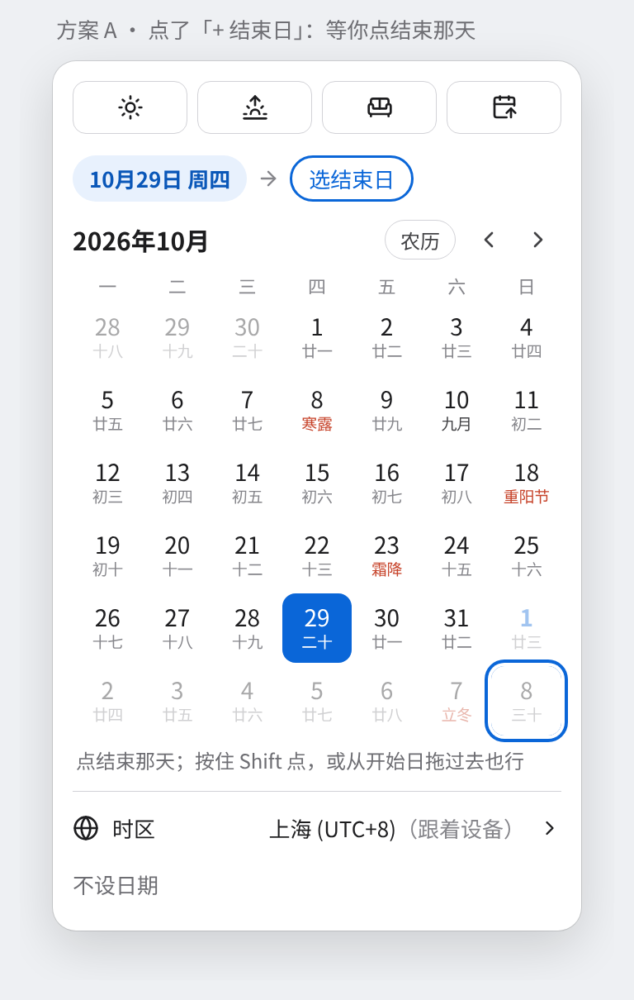
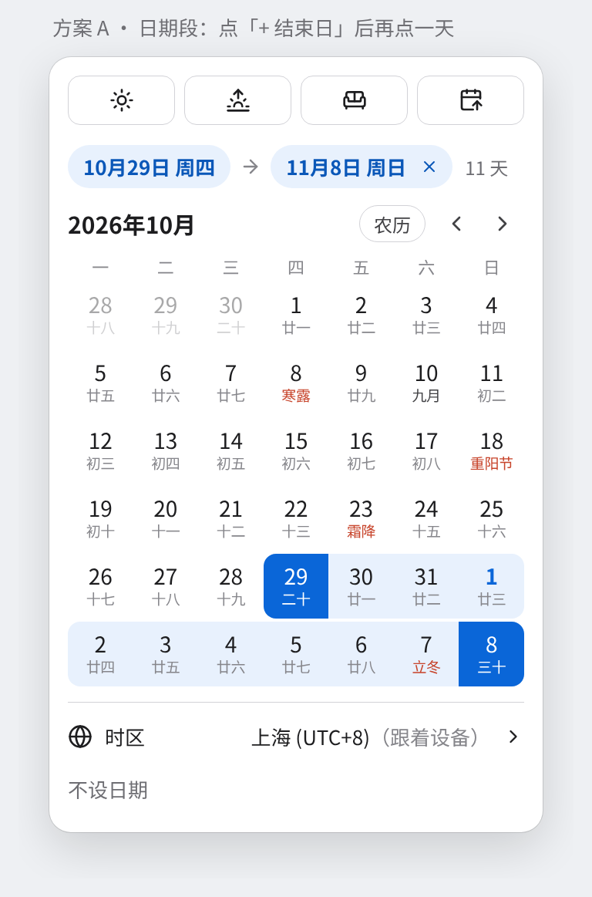
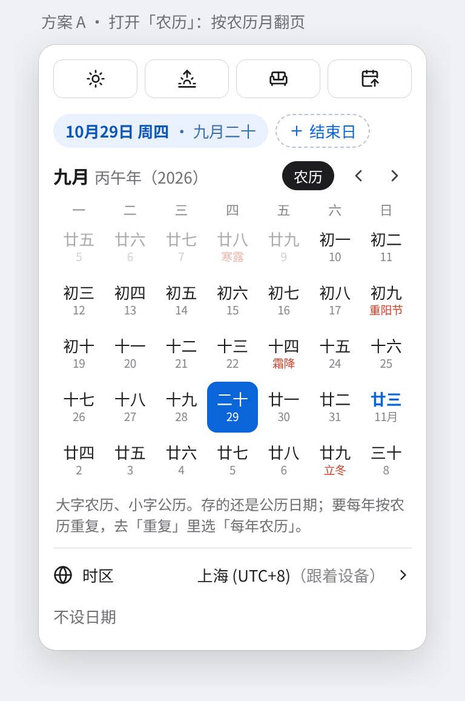
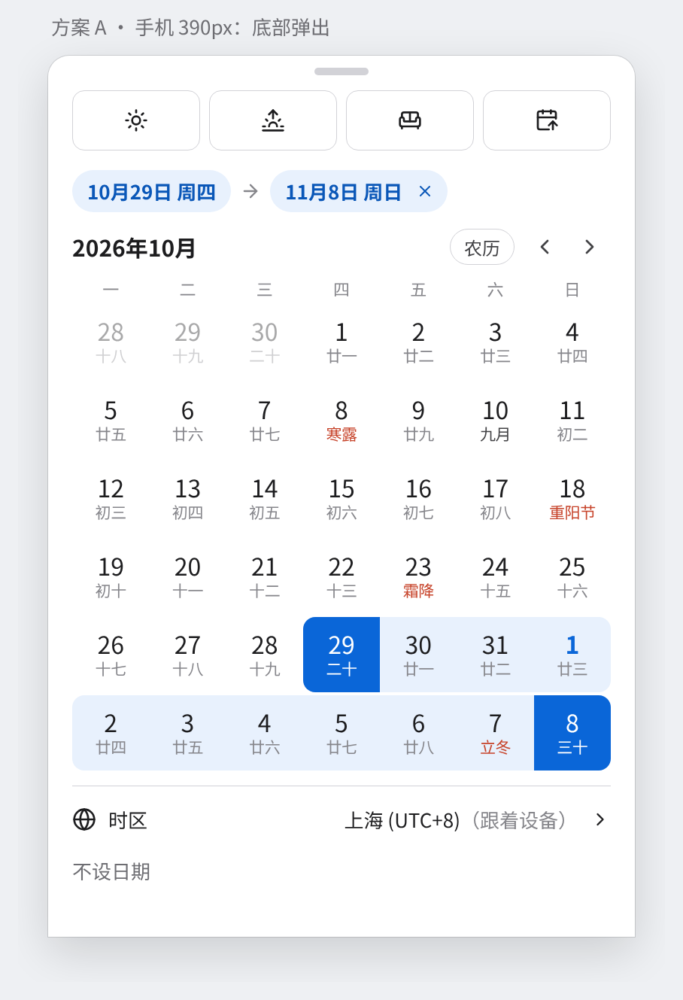
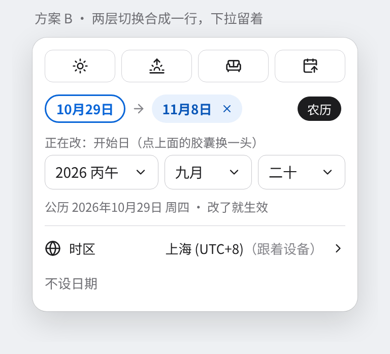
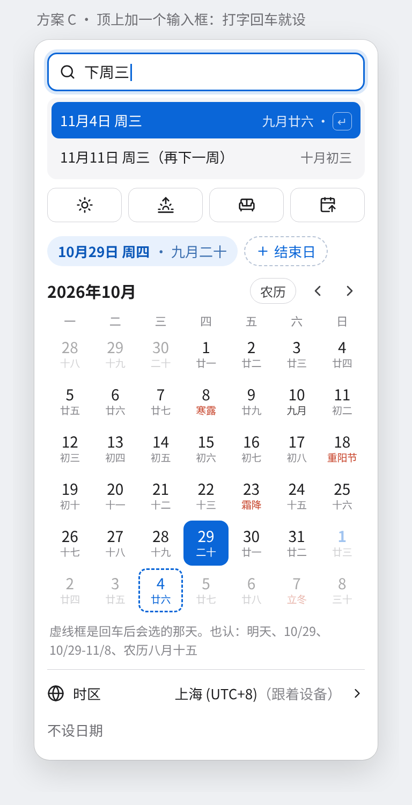

# 日期选择器交互方案（已定方案 A）

Rei 2026-11-01：「当前的 date picker 中：单日、时间段第一层，公历、农历第二层好乱。有什么更好的交互方式么，让我审核」

**已定：方案 A**（Rei 2026-11-01「方案A」），2026-11-01 已经按它改完代码。下面「待确认」的 8 条 Rei 没单独回，都按「建议」做了；做法和跟这份文档不一样的地方见 [PLAN.md](PLAN.md)「日期面板方案 A」。

2026-11-13 又按滴答清单收紧了一次，见「紧凑版」。

**原来的结论：推荐方案 A。** 去掉「单日 | 日期段」「公历 | 农历」两个切换，只留一张月历：点一天就生效，要日期段就点「+ 结束日」再点一天；农历写在每个格子下面，要按农历挑日子时打开月历右上角的「农历」。存法不变，只改界面。

下面的图是写方案时的静态示意图（Apple 皮肤），农历字用的是仓库里 `packages/core/src/lunar` 算出来的真实数据（2026年10月29日 = 农历九月二十）。

## 紧凑版（2026-11-13）

Rei 2026-11-13：「参考图二，让date的popup更紧凑一点」（图二是滴答清单的日期选择）。结构和点法照方案 A 不变，只收紧尺寸，功能一个没删。

改了这些：

- **快捷按钮**：去掉边框，成了一排纯图标（图标 18px，按钮高 32px）。悬停浅灰底，选中浅蓝底。悬停 / 长按提示和读屏名照旧（今天、明天、本周末、下周一）。
- **标题行**：右边成了「‹ ○ ›」，按钮 28px。○ 是「回到今天」：翻回今天那个月（农历页回今天所在的农历月），焦点落在今天，已选的日子不动。悬停提示和读屏名都是「回到今天」，文案沿用打卡页那条，九种语言都有。「农历」开关照旧放在 ‹ 左边。
- **格子**：30×30，行距 44 → 30（原来开农历或节假日时格子 40×42，行间还空 2px）。开不开农历一样大，数字 13.5px、农历小字 9px；小字可以比圆宽，不截字。选中 Apple、Material 是圆，WinUI 开农历时是 4px 圆角方块（和原来一样）。星期那行 24 → 22。
- **休 / 班**：改成右上角实心小圆（12px，绿底「休」、红底「班」，白字），压在格子圆的边上。数据还是订阅的节假日，没有订阅就不出。
- **底部**：时区和「不设日期」放一行。地球图标就代表时区，「时区」两个字只留给读屏；点开时区列表时它占满一行，「不设日期」挪到下面。
- **间距**：面板里各块的间距 12 → 8，胶囊高 28 → 26，面板宽统一 280（原来开农历是 304）。
- **手机**：格子 40×40（原来 42，开农历 50；Material 原来 48），行距 52 → 40；快捷按钮 40 高；标题行三个按钮、「农历」、胶囊、时区、「不设日期」都不小于 36。

量出来的高度（新建任务里打开，今天已选，Chromium，2026-11-13；三套皮肤亮暗一样）：

| | 改前 | 改后 |
| --- | --- | --- |
| 电脑 1366，弹层总高 | Apple / WinUI 517.8，Material 521.8 | Apple / WinUI 377，Material 383 |
| 电脑，面板内容高 | 491.8（Material 495.8） | 351（Material 357） |
| 手机 390，面板内容高 | 553.8 | 449 |
| 手机，弹层总高 | Apple 437（放不下，要滚），WinUI 522，Material 587.8 | Apple 437（还差一点，要滚），WinUI / Material 483 |
| 格子行距（电脑 / 手机） | 44 / 52 | 30 / 40 |

自查脚本和截图在工作区 `work/datepop-compact/dp.mjs`、`work/shots-d1113-datepop/`（before / after）。

## 现在的样子和问题

从上到下：四个快捷图标按钮 →「单日 | 日期段」→ 日期段时的「开始 / 结束」两格 →「公历 | 农历」→ 农历时三个下拉（年 / 月 / 日）+「公历 2026年10月29日 周四」+「已选这天」→ 整段文字 → 时区 →「去掉结束日」→「不设日期」。

问题：

1. **两层切换叠在一起。** 每一层都会改掉下面那块的意思：先决定单日还是日期段，再决定公历还是农历，下面的月历或下拉才是真正选日子的地方。要先读懂两层开关，才知道自己在改什么。
2. **日期段要先选「开始 / 结束」框再改。** 点格子之前得看清楚哪一格描了边，点错一头就改错。
3. **农历模式要点「已选这天」才算数。** 公历点一下就生效，农历却要多按一次，两种手感不一样。
4. **「去掉结束日」和「单日」重复。** 两个入口干同一件事。
5. **农历只能用三个下拉选。** 看不到前后几天，看不到星期，也看不到节气和节日；而公历月历格子下面其实已经写着农历小字了。

## 要保留的功能

方案只改怎么点，下面这些都不变（来自 `DatePanel.tsx`、`TaskDatePicker.tsx` 和 `docs/PRODUCT.md` 第 20 条）：

- **存法**：任务存 `scheduled_date`（单日或段的开始）和 `end_date`（段的结束，单日为空）。按农历选的日子存成公历，是一次性的；要每年按农历重复，走「重复」里的「每年农历」，不在日期面板里。
- **农历只在「中文界面 且 设置里中国农历开着」时出现**（`useLunar().show`）。其他时候面板里没有任何农历字样，格子也是只有数字的小圆格。
- **格子下的小字**：订阅日历的节日 > 传统节日 > 节气 > 初一写月名（「九月」「闰六月」）> 日子（「廿三」）；放假标「休」、调休上班标「班」；悬停和读屏是全称「农历九月十四 · 霜降」。
- **快捷按钮**：今天 / 明天 / 本周末 / 下周一，图标按钮，悬停或长按显示文字。日期段时点快捷项：开始挪到那天，天数不变（`shiftRangeTo`）。
- **时区**：底部「时区」一行；「今天」、快捷项、过期都按任务时区的今天算（`zoneToday`）。
- **过期**：过期变红是胶囊和顶栏日期按钮的事（`dateChipState`），面板本身不变，过去的日子照样能选。
- **一周从哪天开始**跟着语言（`weekStartsOn()`），中文是周一。
- **其他地方也用这个面板**：倒数日的目标日等。没给 `onRangeChange` 的地方没有日期段，方案里的「+ 结束日」也就不出现。

## 方案 A（推荐）：一张月历，点一下就生效

从上到下：

1. 快捷按钮一排（不变）。
2. **已选胶囊**：单日是「10月29日 周四 · 九月二十」，后面一个虚线「+ 结束日」；日期段是「10月29日 周四」→「11月8日 周日 ×」+ 灰字「11 天」。
3. **月历**：标题「2026年10月」，右边一个小的「农历」文字开关和 ‹ ›。每个格子大字公历、小字农历；初一写月名，节日和节气用强调色。
4. 分隔线下面：时区、不设日期。

不再有「单日 | 日期段」「公历 | 农历」「开始 / 结束」两格、「已选这天」「去掉结束日」。

### 怎么操作

**设单日**

1. 点一天。马上存，弹层收起（和现在单日一样）。

**设日期段**

1. 先有一个开始日（点一天，或者本来就有）。
2. 点「+ 结束日」。胶囊变成「10月29日 周四 → 选结束日」，月历下面一行提示「点结束那天」。
3. 点结束那天。中间连成一条，存好，弹层收起。

快一点的两种办法（桌面）：

- 已经有开始日时，**按住 Shift 点**另一天，直接变成日期段。
- **从开始那天拖到结束那天**，松手就是一段。

**改日期段**

- 段已经设好时点任意一天：点在开始日之前，改开始；点在之后，改结束（规则沿用现在的 `pickRangeDay`，细节见待确认第 3 条）。
- 点结束日胶囊上的 ×，去掉结束日，变回单日。
- 点快捷按钮：开始挪到那天，天数不变（和现在一样）。

**按农历挑日子**

1. 点月历右上角「农历」。开关变黑底白字。
2. 月历按农历月翻页：标题「九月 丙午年（2026）」，格子大字农历、小字公历（公历每月 1 号写「11月」），节日节气照样标出来。闰月单独一页，标题「闰六月」。
3. 点一天，和公历一样马上生效。日期段也一样能选。
4. 月历下面一行灰字：「大字农历、小字公历。存的还是公历日期；要每年按农历重复，去「重复」里选「每年农历」。」

农历开关只在农历界面显示时出现。

### 优点

- 只有一个地方选日子。农历模式下少了三个下拉和一个确认按钮，面板反而矮了：按图量，现在日期段 + 农历时约 555px 高，方案 A 约 500px，还多看到一整个月。
- 单日、日期段、公历、农历的点法完全一样：点一天就生效。
- 已选的日子一直写在顶上，农历也写在胶囊里，不用切过去看。
- 改日期段不用先选「开始 / 结束」框。

### 缺点

- 「+ 结束日」藏在胶囊后面，第一次用的人可能找不到日期段（胶囊用虚线框和「+」号，比较显眼）。
- 农历月历要自己画：react-aria 的 `Calendar` 只能按公历排，`@internationalized/date` 也没有中国农历。农历那页得自己写一个 `role="grid"` 的格子组件。
- 拖选要自己处理指针事件，或者日期段时换成 react-aria 的 `RangeCalendar`（它自带拖选，但不支持「先有开始日再等结束」的状态，可能还是自己画高亮更省事，现在的代码就是这么做的）。

### 改动量

- `DatePanel.tsx`：重写主体，去掉 `Segmented` 两处、`RangeEnds`、`LunarPicker`（约 300 行改成 350 行左右）。
- 新组件 `LunarMonthGrid`：按农历月排格子，含闰月、键盘导航，大约 150 行。core 里 `lunarYearMonths`、`lunarToSolar`、`solarToLunar` 已经够用，不用加新算法。
- `pickRangeDay`、`shiftRangeTo`、`rangeCellRole` 不用改，或者只加「Shift 点」一条分支。
- `lunar.css`：加选中胶囊、农历页的样式；三套皮肤各补一节。
- `docs/COPY.md`：删「单日 | 日期段」「公历 | 农历」「开始 / 结束」「已选这天 / 选这天」「去掉结束日」，加「+ 结束日」「选结束日」「农历」开关、胶囊读屏名。九种语言的译文跟着改。
- 测试：core 的日期段测试照旧；加界面测试覆盖点一下生效、+ 结束日、Shift 点、农历页翻到闰月。
- 估计 1.5–2 天。

### 键盘和读屏

- 打开面板，焦点落在已选那天（没选落在今天）。方向键换天，PageUp / PageDown 换月（农历页换农历月），Shift+PageUp / PageDown 换年，Enter 或空格选中。
- 有开始日时按 **Shift+Enter** 设成结束日（对应鼠标的 Shift 点）。
- Tab 顺序：快捷按钮 → 已选胶囊（× 能单独 Tab 到）→「+ 结束日」→「农历」开关 → 上个月 / 下个月 → 月历 → 时区 → 不设日期。
- 格子读屏名：「10月29日 星期四，农历九月二十，已选」；节气节日加在后面「10月23日 星期五，农历九月十四，霜降」；段里的写「在日期段里」。
- 选中后用 live region 念一句：「日期设为 10月29日 周四」/「日期段 10月29日 到 11月8日，11 天」。
- 「农历」开关读屏「按农历看月历」，带 `aria-pressed`。
- 「+ 结束日」读屏「加结束日，变成日期段」；结束日胶囊的 × 读屏「去掉结束日」。

### 手机 390px

- 从底部弹出（sheet），顶上一条拖动把手。宽度撑满，格子 50px 高、数字 16px、农历小字 10.5px，点的地方够大。
- 快捷按钮 40px 高。
- 已选胶囊一行放得下「10月29日 周四 → 11月8日 周日 ×」；放不下时（年份不同、英文）换成两行，不截字。
- 手机上没有 Shift，也不做拖选（和 sheet 下拉关闭冲突），日期段只走「+ 结束日」。
- 左右滑动月历可以翻月（可选，见待确认）。

### 三套皮肤

- **Apple**：白色弹层、大圆角；胶囊是浅蓝底深蓝字；「农历」开关是小圆角文字按钮，开着黑底白字；格子选中是蓝色圆角方块，段中间浅蓝条。图就是这个样子。
- **WinUI 3**：弹层用 Flyout 样式（Mica / Acrylic 底、细描边）；格子选中按 CalendarView 的样子用强调色填充，今天用强调色描边；「农历」用 ToggleButton 样子；胶囊换成 4px 圆角的小标签；焦点框用 WinUI 的双层焦点框，别被格子背景盖住。
- **Material 3**：格子选中是 40dp 圆形，段中间用 secondary container 色的横条；胶囊用 input chip（带尾部 ×），「+ 结束日」用 assist chip，「农历」用 filter chip；手机上是 Material 的 bottom sheet，点的地方不小于 48dp。农历小字放进圆形里会挤，Material 下格子用圆角方块，和现在 `has-lunar` 的做法一样。

## 方案 B：结构不动，两层合成一行

### 怎么操作

1. 顶上快捷按钮不变。
2. 下面一行：左边是已选胶囊「10月29日 → 11月8日 ×」（单日时只有一个胶囊 +「+ 结束日」），右边一个小「农历」开关。
3. 公历时下面是现在的月历；农历开着时是现在的三个下拉。
4. 日期段时，点哪个胶囊就改哪一头（描边的那个就是正在改的）。
5. 下拉一改就生效，去掉「已选这天」按钮。

### 优点

- 改动小：月历和 `LunarPicker` 都留着，只是把两个 `Segmented` 换成胶囊和小开关，大约半天。
- 不用自己画农历月历。

### 缺点

- 农历还是三个下拉，看不到前后几天和星期。
- 日期段还得先点胶囊选一头，问题 2 只是好看了一点。
- 下拉一改就生效，滚动年份时任务日期会跟着跳来跳去（每改一格都存一次）。

### 键盘和读屏、窄屏、皮肤

- 下拉保持现在的 `Select`，键盘和读屏都不变；胶囊是按钮，`aria-pressed` 表示正在改的那头。
- 390px 时三个下拉一行放得下（年 1.3 份、月日各 1 份）。
- 三套皮肤只要给胶囊和小开关补样式，下拉沿用各皮肤现有的样子。

## 方案 C：A 再加一个输入框

### 怎么操作

1. 面板顶上多一个输入框，打开面板时焦点在这里。
2. 打「下周三」，下面马上列出解析结果「11月4日 周三 · 九月廿六 ↵」，月历上那天画虚线框。
3. 回车就设好，弹层收起。上下键可以挑第二个结果（「11月11日 周三（再下一周）」）。
4. 能打的例子：明天、3 天后、下周三、10/29、10/29-11/8、农历八月十五。
5. 不打字的话，就是方案 A。

### 优点

- 键盘用户最快，打两三个字回车就完。
- 「农历八月十五」这种一句话就能定，不用开农历页翻。

### 缺点

- 要写解析器：中文、英文还好，九种语言（中、英、西、葡、俄、日、德、法、印尼）都要支持就是大活。可以先只做中文和英文，其他语言不显示输入框。现成的解析库（比如 chrono-node）要先核对它支持哪几种语言、中文认不认「下周三」「农历」，再决定用不用。
- 「下周三」有歧义（今天是周日时，指这周三还是下一个周三），要定规则并在结果里写清楚。
- 面板又高了一截（加约 80px）。

### 改动量

- 在 A 的基础上加 1–2 天（中英文解析 + 测试）。其他语言另算。
- 可以等 A 上线后再加，A 的结构不用改。

### 键盘和读屏、窄屏、皮肤

- 输入框是 combobox，结果列表是 listbox，上下键挑、回车选、Esc 清空（再按一次 Esc 关弹层）；读屏念「11月4日 周三，农历九月廿六，回车设定」。
- 手机上默认不自动聚焦输入框，免得一打开就弹键盘挡住月历。
- 三套皮肤用各自的搜索框样式；Material 用 filled text field。

## 三个方案对比

| | A（推荐） | B | C |
| --- | --- | --- | --- |
| 选一天 | 点一下 | 点一下（农历改下拉） | 点一下，或打字回车 |
| 日期段 | + 结束日 / Shift 点 / 拖 | 先点胶囊再点日子 | 同 A，也能打「10/29-11/8」 |
| 农历 | 格子小字 + 农历月历 | 格子小字 + 三个下拉 | 同 A，也能打「农历八月十五」 |
| 确认按钮 | 没有 | 没有 | 没有 |
| 改动量 | 1.5–2 天 | 半天 | A + 1–2 天 |

## 待确认（Rei 没单独回，按建议做了）

1. **点一下要不要直接关弹层？** 建议：单日点一下就存并关（和现在一样）；要日期段时再打开点「+ 结束日」。另一种是点了不关，要点外面才关。
2. **日期段要不要拖选？** 建议：桌面支持拖选和 Shift 点，手机只用「+ 结束日」。
3. **段已经设好时点一天改哪头？** 建议：点在开始之前改开始，点在结束之后改结束，点在中间改结束（离哪头近改哪头也行，但不好猜）。
4. **「农历」开关记不记住上次？** 现在的公历 / 农历切换记在本机（`mindough:lunar-pick`）。建议：照旧记在本机。
5. **快捷按钮留哪几个？** 现在是今天、明天、本周末、下周一。建议四个都留；或者把「本周末」换成「不设日期」挪到上面来。
6. **节气节日要不要标？** 建议：照旧标（强调色），只在农历开着时出现；「休 / 班」角标也留着。
7. **周一还是周日开头？** 现在跟着界面语言（`weekStartsOn()`）。要不要加一个设置项让人自己选？建议：先不加。
8. **方案 C 的输入框什么时候做？** 建议：先上 A，C 以后再说，先只做中文和英文。
